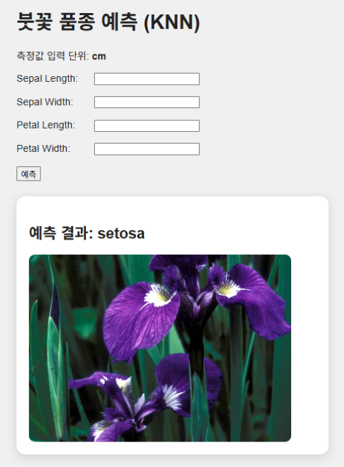
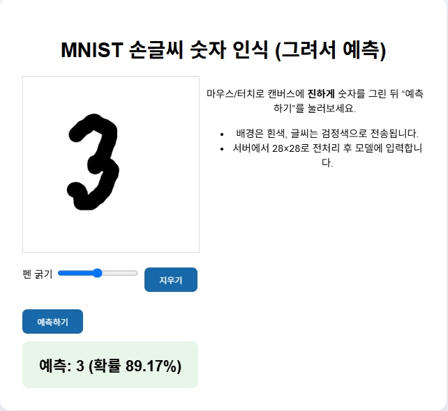

# DL Project

머신러닝 · 딥러닝 모델을 직접 학습시키고, 
Flask 웹 화면에서 바로 써 볼 수 있게 만든 학습 프로젝트 모음입니다.

## 기술 스택

---

## 📁 이론 정리

1. [Docker · Flask · HTTP](./theory/docker_flask_http/docker_flask_http.md)

## 📁 기초 연습

- [Flask 기본 예제](./flask/hello.py)

---

 

## 🚀 프로젝트

### 🌸 Iris KNN 품종 분류

> 붓꽃 측정값 4개로 품종(Setosa · Versicolor · Virginica)을 맞히는 웹 앱 *(머신러닝 · KNN)*
>
> - 모델: KNN (scikit-learn)
> - 데이터: scikit-learn 내장 Iris 데이터셋
>
> 

> 
실행 화면

>
> 
>
> 

>
>    
>
> [상세보기 →](./flask/iris_knn_flask/)

 

### ✍️ MNIST 손글씨 숫자 인식

> 캔버스에 쓴 숫자를 0부터 9 중에서 맞히는 웹 앱 *(딥러닝 · CNN)*
>
> - 모델: CNN (TensorFlow · Keras)
> - 데이터: MNIST 손글씨 숫자 데이터셋
>
> 

> 
실행 화면

>
> 
>
> 

>
>    
>
> [상세보기 →](./tensorflow/MNIST/)
