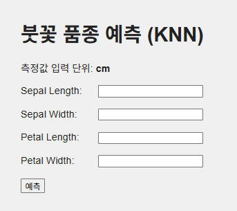
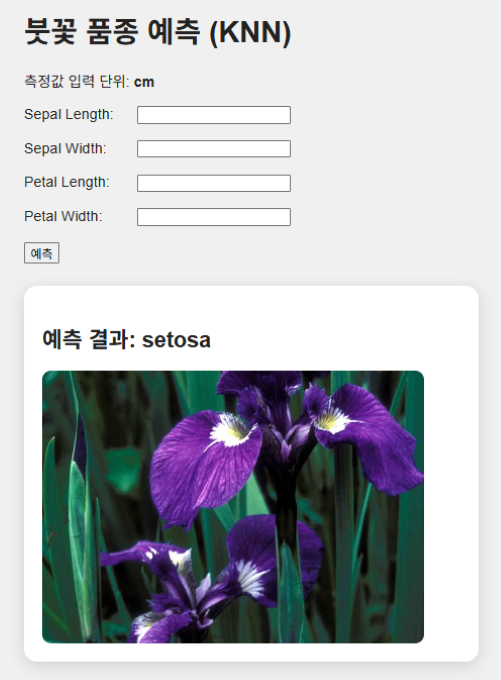
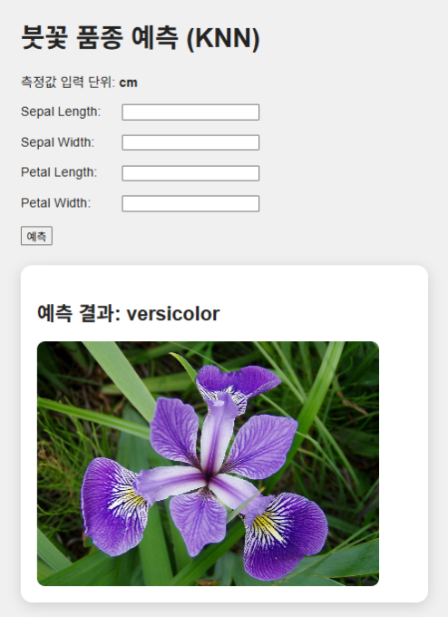
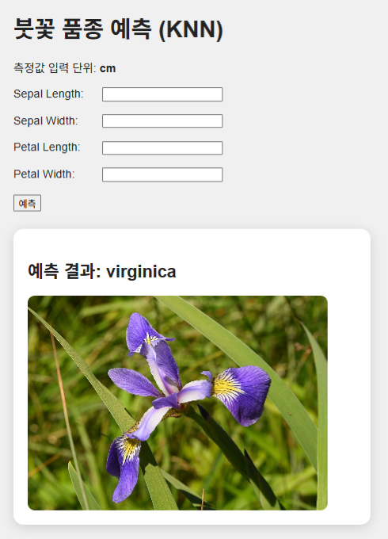
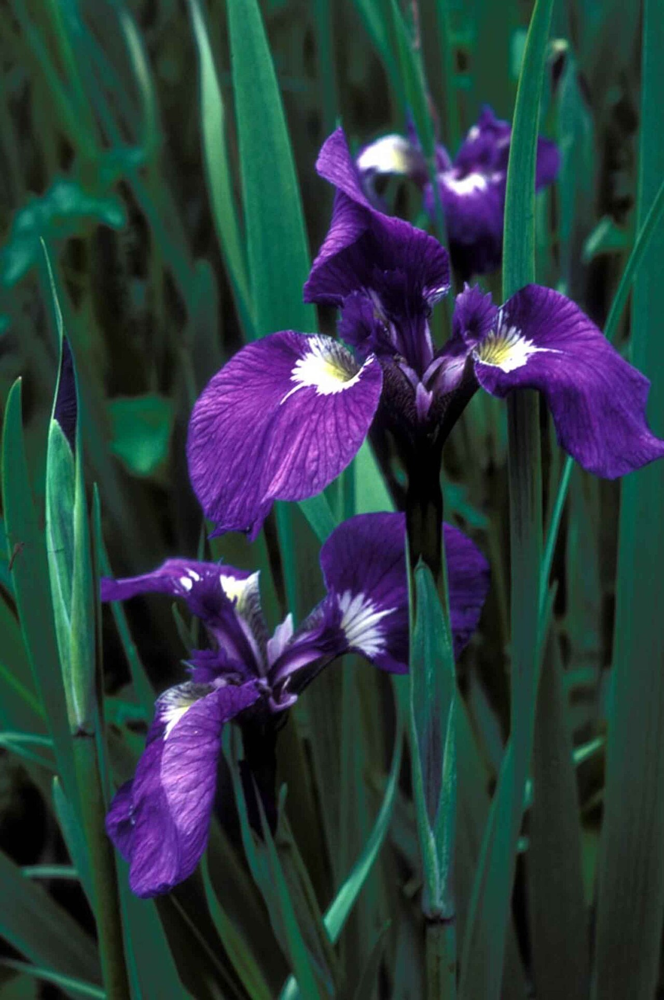
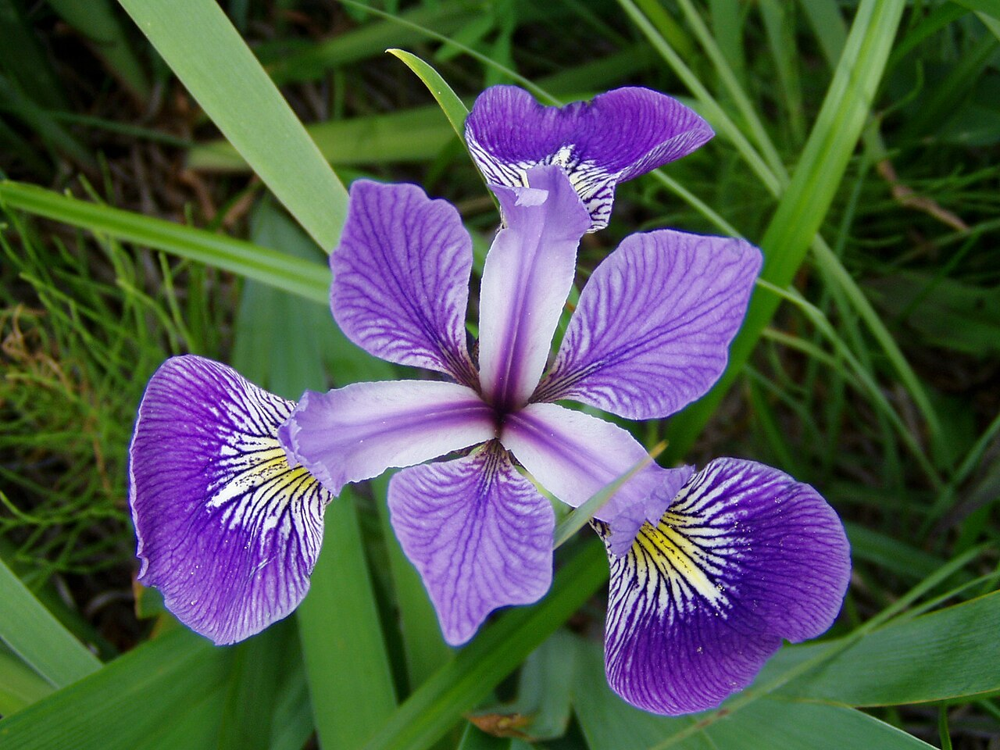
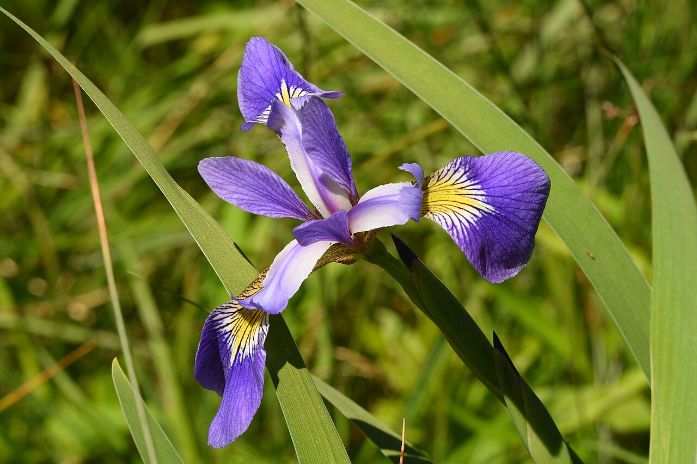

# Iris KNN Flask

## 개요

- Iris 데이터셋 기반 붓꽃 품종 분류
- KNN 알고리즘 기반 예측
- Flask 기반 웹 애플리케이션
- Docker 기반 실행 환경
- 사용자 입력값 기반 품종 예측
- 예측 품종별 이미지 출력

## 사용 기술


## 입력 항목

- 꽃받침 길이: `Sepal Length`
- 꽃받침 너비: `Sepal Width`
- 꽃잎 길이: `Petal Length`
- 꽃잎 너비: `Petal Width`
- 입력 단위: `cm`

## 예측 대상

- `setosa`
- `versicolor`
- `virginica`

## 실행 화면

### 입력 화면

- 붓꽃 측정값 입력
- 예측 버튼 실행



### 분류 결과

<div align="center">
  
  
  
</div>

### 품종별 이미지

| Setosa | Versicolor | Virginica |
|:---:|:---:|:---:|
|  |  |  |

## 모델 구성

- 알고리즘: KNN
- 이웃 수: `3`
- 입력값: 측정값 4개
- 출력값: 품종 3개
- 모델 파일: `model/iris_model.pkl`

## 파일별 기능

- `app.py`: Flask 실행 및 품종 예측
- `train_model.py`: KNN 모델 학습 및 저장
- `templates/index.html`: 입력 및 결과 화면
- `model/iris_model.pkl`: 학습 모델
- `static/images/`: 품종 이미지 및 실행 화면 캡처

## 모델과 이미지의 관계

- 모델 학습 데이터: Iris 측정값 4개
- 이미지 사용 목적: 예측 결과 시각화
- 이미지 학습 여부: 미사용
- 이미지 출력 시점: 품종 예측 완료 후

## 프로젝트 구조

```text
iris_knn_flask/
├─ app.py
├─ train_model.py
├─ README.md
├─ model/
│  └─ iris_model.pkl
├─ templates/
│  └─ index.html
└─ static/
   └─ images/
      ├─ setosa.jpg
      ├─ versicolor.jpg
      ├─ virginica.jpg
      ├─ input_screen.png
      ├─ result_setosa.png
      ├─ result_versicolor.png
      └─ result_virginica.png
```

## 처리 과정

- Iris 데이터셋 불러오기
- KNN 모델 학습
- 학습 모델 저장
- Flask 앱 실행
- 사용자 입력값 수집
- 품종 예측
- 예측 품종명 출력
- 품종별 이미지 출력

## 실행 방법

### Docker 실행

```powershell
docker build -t iris-knn-flask .
docker run -p 5000:5000 iris-knn-flask
```

브라우저 접속:

```text
http://127.0.0.1:5000/
```

### Flask 실행

```bash
python3 app.py
```