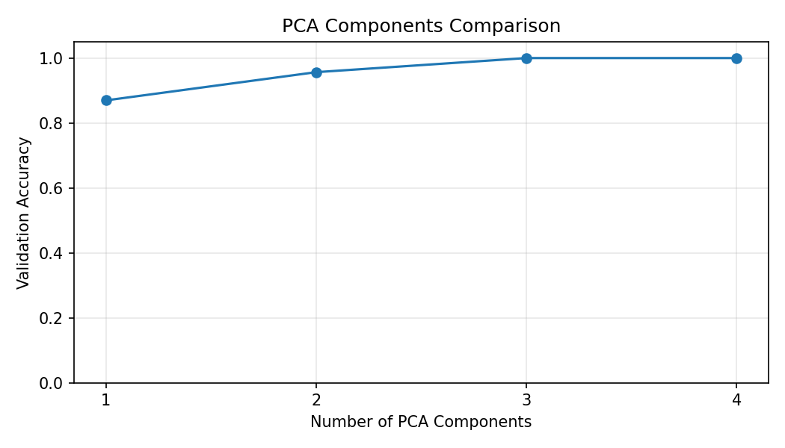
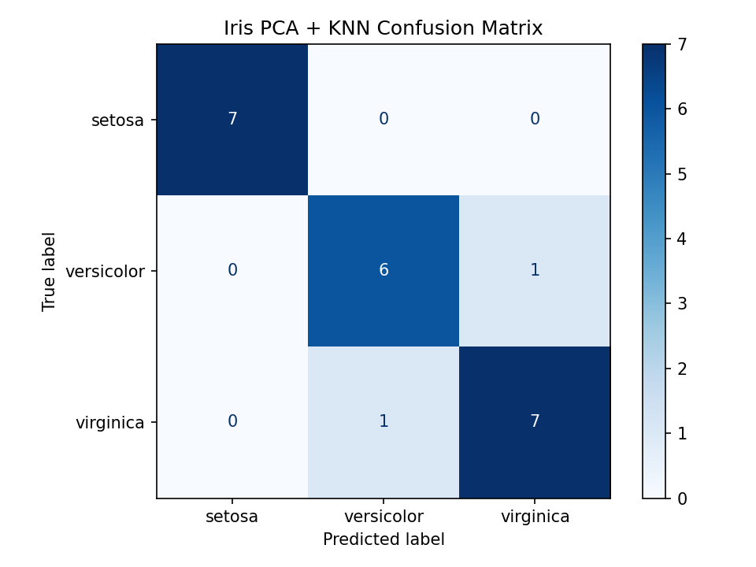
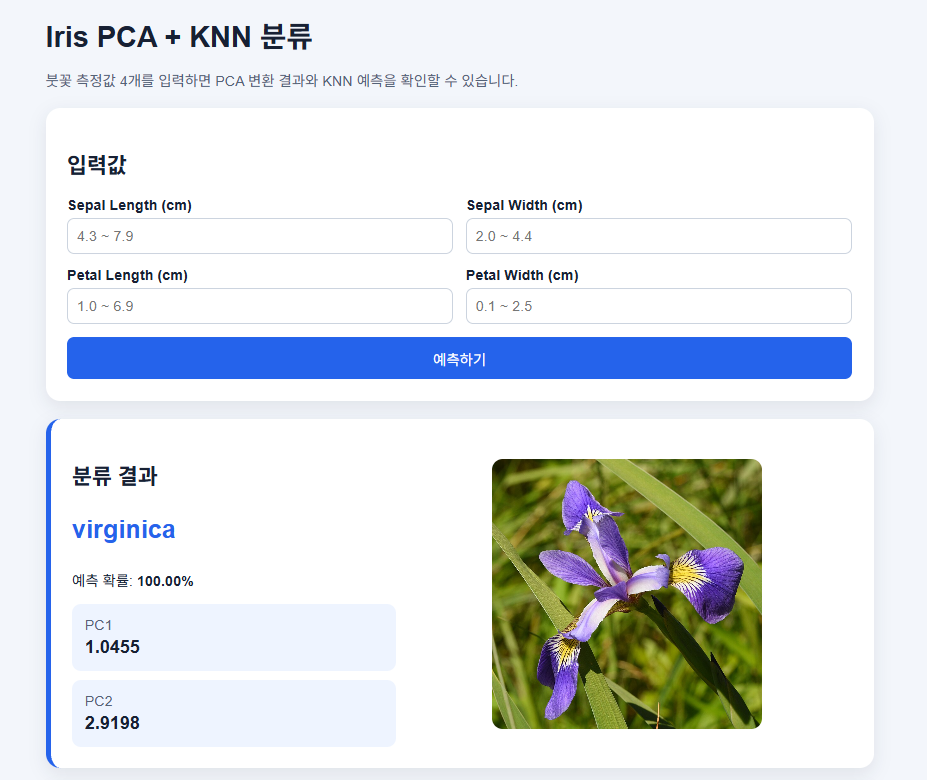
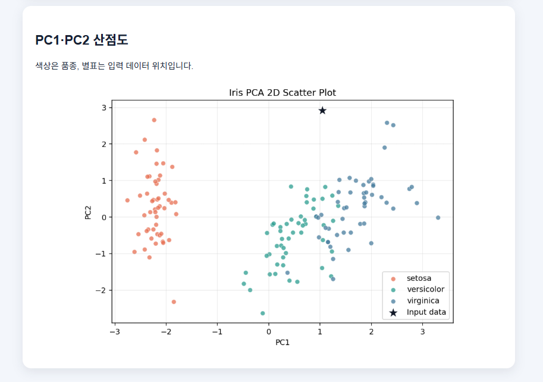

# Iris PCA + KNN Flask

> Iris 측정값 4개를 PCA로 2차원 축소한 뒤 KNN으로 품종을 분류하는 Flask 웹 애플리케이션

---

## 1. 프로젝트 개요

Iris 데이터셋의 4개 측정값을 입력받아 PCA로 2차원 축소 후 KNN으로 붓꽃 품종을 분류하는 Flask 웹 애플리케이션

---

## 2. 프로젝트 목표

Iris 품종 분류 · PCA 차원 축소 · KNN 하이퍼파라미터 비교 · PC1·PC2 산점도 시각화 · 웹 예측 · 품종 이미지 출력

---

## 3. 사용 기술


- Python: 학습 코드 및 Flask 서버
- Flask: 웹 애플리케이션 구성
- NumPy: 배열 및 데이터 처리
- scikit-learn: StandardScaler, PCA, KNN, 평가 지표
- Matplotlib: PCA 산점도 및 혼동행렬 시각화
- HTML5·CSS3: 입력 화면 및 결과 화면 구성
- Pickle: 학습 Pipeline 저장 및 불러오기

---

## 4. 데이터셋

- 데이터셋: Iris / 전체 샘플: 150개 / 품종: Setosa, Versicolor, Virginica
- 입력 특성: Sepal Length, Sepal Width, Petal Length, Petal Width / 입력 단위: cm
- 구성: 품종 3개 / 입력 특성 4개

---

## 5. 이론

### 5.1 StandardScaler

- 표준화 전처리 / 평균 0 변환 / 표준편차 1 변환 / 특성별 측정 범위 조정 / PCA·KNN 적용 전 처리

- 적용 대상: 꽃받침 길이·너비, 꽃잎 길이·너비
- 적용 이유: 특성별 측정 범위 차이 조정
- 미적용 시: KNN 거리 계산에서 값의 범위가 큰 특성의 영향 증가

표준화 공식:

```text
z = (x - 평균) / 표준편차
```

### 5.2 PCA (Principal Component Analysis)

- 고차원 특성의 차원 축소 방법
- 원본 특성의 분산을 기준으로 새로운 축 생성
- 특성 간 상관관계 반영
- 데이터의 주요 방향 추출
- PC1: 가장 큰 분산을 설명하는 첫 번째 주성분
- PC2: PC1과 다른 방향의 두 번째 주성분
- 원본 특성 4개를 PC1·PC2 2개로 축소
- PCA 좌표의 음수: 평균 기준 반대 방향의 좌표
- PCA 결과의 단위: 원본 cm와 다른 변환 좌표

PCA 처리 흐름:

```text
Sepal Length
Sepal Width
Petal Length       → StandardScaler → PCA → PC1, PC2
Petal Width
```

- PC1·PC2: 원본 특성 4개의 조합으로 생성된 좌표축
- PC1: 데이터 분산 설명량이 가장 큰 방향
- PC2: PC1과 직교하는 두 번째 방향
- PC1·PC2: 실제 측정 항목이 아닌 PCA 변환 결과

PCA의 주요 목적:

- 특성 수 감소
- 데이터 구조 단순화
- 시각화 차원 확보
- 특성 간 중복 정보 감소
- KNN 계산 차원 감소

### 5.3 KNN

- K-Nearest Neighbors / 거리 기반 분류 / 가까운 이웃 `k`개 선택 / 다수 클래스 기준 분류

예측 과정:

```text
새로운 입력값 → 기존 데이터와 거리 계산 → 가까운 k개 데이터 선택 → 품종별 투표 → 예측 품종 결정
```

`k`의 영향:

- `k=1`: 가장 가까운 1개 이웃만 사용, 개별 샘플 영향 최대
- `k=9`: 가까운 9개 이웃 사용, 주변 샘플 평균 영향 증가
- 작은 `k` 경향: 학습 데이터에 민감, 과적합 가능성
- 큰 `k` 경향: 분류 경계 단순화, 과소적합 가능성
- 홀수 `k`: 다수결 동률 가능성 감소

### 5.4 데이터 분할

- 역할: Train 모델 학습 / Validation 하이퍼파라미터 비교 / Test 최종 성능 평가
- 분할 비율: Train 70% / Validation 15% / Test 15% / 샘플 수: 105개 / 23개 / 22개

- 전체 150개: Train 105개 / Validation 23개 / Test 22개

`stratify=y`를 사용해 세 품종의 클래스 비율을 각 데이터에 유지합니다. `random_state=42`를 사용해 동일한 분할 결과를 재현합니다.

### 5.5 데이터 누수 방지

- Scaler: Train 데이터로만 `fit`
- PCA: Train 데이터로만 `fit`
- Validation·Test: 학습된 Scaler와 PCA로 `transform`
- Test 데이터: 최종 평가 단계에서만 사용

Pipeline 구성:

```text
StandardScaler → PCA → KNN
```

Pipeline 사용 이유:

- 전처리와 모델의 순서 고정
- 교차 처리 과정의 일관성 유지
- 학습·검증·테스트 변환 기준 통일
- 전처리 단계의 데이터 누수 방지


---

## 6. 실험 설정

- 분할: Train 70% / Validation 15% / Test 15%
- 샘플 수: Train 105개 / Validation 23개 / Test 22개
- 클래스 비율 유지: `stratify=y` / 재현성 설정: `random_state=42`

---

## 7. 선택 사항 및 선택 이유

### 6.1 PCA 주성분 수

- 선택: `PCA(n_components=2)`
- 이유: 원본 특성 4개를 PC1·PC2로 축소하고 2차원 산점도로 시각화
- 비교 결과: PCA 1개 `86.96%`, PCA 2개 `95.65%`, PCA 3개 `100%`, PCA 4개 `100%`
- 최종 선택: 웹 산점도 구성을 위해 PCA 2개 유지

### 6.2 KNN의 k 값

- 비교 후보: `1, 3, 5, 7, 9` / 비교 기준: Val Accuracy / 동률 처리: 가장 작은 `k` 선택 / 선택 결과: `k=5`

### 7.3 검증 기준

- Test 데이터: 최종 평가 단계에서만 사용
- Scaler·PCA: 학습 데이터 기준 `fit`, Validation·Test 데이터 기준 `transform`
- Pipeline: StandardScaler → PCA → KNN 순서 고정
- Validation 재사용: k 비교와 PCA 주성분 비교에 사용
- 해석: PCA 3·4개의 Validation 100%는 참고 결과로 기록, 웹 모델은 PCA 2개 유지

### 7.4 PCA 주성분 수 비교

- 비교 후보: `1, 2, 3, 4`
- KNN `k`: `5` 고정
- 비교 기준: Val Accuracy
- 웹 시각화 모델: PC1·PC2 사용을 위해 `PCA(n_components=2)` 유지

---

## 8. 실험 결과

| k | Val Accuracy |
|---:|---:|
| 1 | 82.61% |
| 3 | 82.61% |
| 5 | 95.65% |
| 7 | 95.65% |
| 9 | 95.65% |

- 선택된 k: `5`
- 최고 Validation Accuracy: `95.65%`
- Test Accuracy: `90.91%`
- Test 정답 수: 20개 / 22개

### PCA 주성분 수 비교



PCA 주성분 수별 Val Accuracy 비교

### Test 혼동행렬



실제 품종과 예측 품종 비교

---

## 9. 실행 화면

### 8.1 입력 및 분류 결과

- 측정값 4개 입력
- 예측 품종 출력
- KNN 이웃 일치율 출력
- PC1·PC2 출력
- 예측 품종 이미지 출력



입력값·예측 결과·PC1·PC2·품종 이미지 표시

### 8.2 PCA 산점도

- x축: PC1
- y축: PC2
- 색상: 품종별 구분
- 별표: 사용자 입력 데이터 위치



PC1·PC2 기준 품종 분포와 입력 데이터 위치 표시

---

## 10. 웹 처리 과정

```text
측정값 4개 입력
        ↓
StandardScaler 변환
        ↓
PCA 차원 축소
        ↓
PC1·PC2 계산
        ↓
KNN 품종 예측
        ↓
KNN 이웃 일치율 및 꽃 이미지 출력
        ↓
PCA 산점도에 입력 위치 표시
```

---

## 11. 실행 방법

### 11.1 가상환경 생성

- 목적: 프로젝트별 패키지 분리

```powershell
python -m venv .venv
```

Windows PowerShell:

```powershell
.\.venv\Scripts\Activate.ps1
```

macOS·Linux:

```bash
source .venv/bin/activate
```

### 11.2 패키지 설치

```powershell
python -m pip install flask numpy scikit-learn matplotlib
```

### 11.3 모델 학습 및 결과 저장

- 이미 저장된 모델이 있는 경우 생략 가능

```powershell
python train_model.py
```

### 11.4 Flask 실행

```powershell
python app.py
```

접속 주소:

```text
http://127.0.0.1:5000/
```

---

## 12. 저장 파일

- `model/iris_pca_knn_pipeline.pkl`
  - StandardScaler, PCA, KNN 포함 Pipeline
- `results/k_comparison.csv`
  - k 후보별 Validation 정확도
- `results/pca_comparison.csv`
  - PCA 주성분 수별 Validation 정확도
- `results/pca_comparison.png`
  - PCA 주성분 수 비교 그래프
- `results/metrics.json`
  - 분할 정보, 선택된 k, 정확도, PCA 설명 분산
- `results/confusion_matrix.png`
  - Test 데이터 혼동행렬
- `results/test_predictions.csv`
  - Test 실제값과 예측값 비교

---

## 13. 프로젝트 구조

```text
iris_pca_knn_flask/
├─ app.py                         # Flask 웹 서버 및 예측 처리
├─ train_model.py                # 데이터 분할, PCA·KNN 학습 및 평가
├─ README.md                     # 프로젝트 설명 및 실험 기록
├─ images/
│  ├─ iris_pca_knn.png           # 입력·분류 결과 화면
│  └─ iris_pca_knn_scatter_plot.png # PCA 산점도 화면
├─ model/
│  └─ iris_pca_knn_pipeline.pkl   # StandardScaler·PCA·KNN Pipeline
├─ results/
│  ├─ confusion_matrix.png       # Test 데이터 혼동행렬
│  ├─ k_comparison.csv           # k 후보별 Validation 정확도
│  ├─ pca_comparison.csv         # PCA 주성분 수별 Validation 정확도
│  ├─ pca_comparison.png         # PCA 주성분 수 비교 그래프
│  ├─ metrics.json               # 실험 설정 및 평가 지표
│  └─ test_predictions.csv       # Test 실제값·예측값 비교
├─ templates/
│  └─ index.html                 # 입력·분류 결과 화면
└─ static/
   ├─ style.css                  # 웹 화면 스타일
   └─ images/
      ├─ setosa.jpg              # Setosa 이미지
      ├─ versicolor.jpg          # Versicolor 이미지
      ├─ virginica.jpg           # Virginica 이미지
      └─ ...                     # 기타 이미지 파일 생략
```

