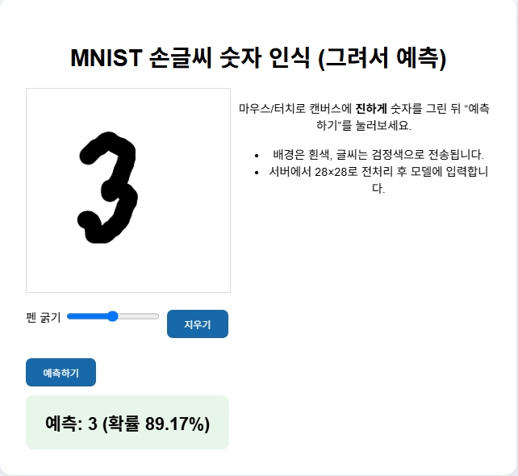
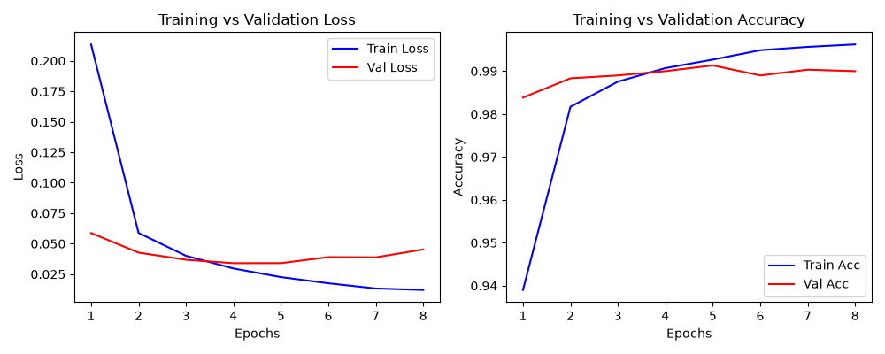

# MNIST 손글씨 숫자 인식

## 개요

MNIST 손글씨 이미지 데이터셋 기반 CNN 숫자 분류 프로젝트

- MNIST 데이터셋 학습
- CNN 모델 기반 숫자 분류
- 캔버스 숫자 입력
- 예측 숫자 및 확률 출력
- 학습 결과 시각화
- Flask 웹 애플리케이션 구성

## 실행 화면

### 숫자 입력 및 예측 결과

캔버스 숫자 입력 후 `예측하기` 버튼으로 결과 확인

<p align="center">
  
</p>

## 사용 기술


## 데이터셋

- 데이터셋: MNIST
- 학습 이미지: 60,000개
- 테스트 이미지: 10,000개
- 이미지 크기: `28 x 28`
- 이미지 형식: 흑백
- 출력 클래스: `0`~`9`

## 모델 구성

- 입력 크기: `28 x 28 x 1`
- 합성곱 레이어: 2개
- 최대 풀링 레이어: 2개
- 평탄화 레이어: `Flatten`
- 완전 연결 레이어: `Dense(128)`
- 출력 레이어: `Dense(10)`
- 활성화 함수: `ReLU`, `Softmax`
- 옵티마이저: `Adam`
- 손실 함수: `sparse_categorical_crossentropy`
- 평가 지표: `accuracy`

## 전처리

- 픽셀값 범위: `0`~`255`
- 정규화 범위: `0`~`1`
- 입력 차원: `28 x 28 x 1`

```python
x_train = x_train.astype("float32") / 255.0
x_test = x_test.astype("float32") / 255.0

x_train = x_train[..., np.newaxis]
x_test = x_test[..., np.newaxis]
```

웹 입력 이미지 전처리 항목

- 흑백 변환
- 픽셀값 정규화
- 이미지 크기 변환
- 채널 차원 추가

## 처리 과정

1. MNIST 데이터셋 불러오기
2. 픽셀값 정규화
3. 입력 차원 추가
4. CNN 모델 구성
5. 학습 데이터와 검증 데이터 분리
6. 모델 학습
7. 최적 가중치 저장
8. 테스트 데이터 평가
9. 학습 결과 그래프 저장
10. 모델 파일 저장
11. Flask 서버 실행
12. 숫자 입력 및 예측 결과 출력

## 학습 결과

학습 손실 및 정확도 그래프



## 웹 기능

| 기능 | 설명 |
|---|---|
| 숫자 입력 | 캔버스 손글씨 입력 |
| 펜 굵기 조절 | 슬라이더 기반 굵기 조절 |
| 지우기 | 캔버스 및 결과 초기화 |
| 예측하기 | 입력 이미지 기반 숫자 예측 |
| 결과 표시 | 예측 숫자 및 확률 출력 |

## 실행 방법

### 패키지 설치

```bash
python -m pip install tensorflow flask numpy pillow matplotlib
```

### 프로젝트 폴더 이동

```bash
cd tensorflow/MNIST
```

### 모델 학습

```bash
python train.py
```

생성 파일

- `model.keras`
- `history.png`
- `checkpoints/best.weights.h5`

### Flask 서버 실행

```bash
python app.py
```

접속 주소

```text
http://127.0.0.1:8888/
```

## 프로젝트 구조

```text
MNIST/
├─ app.py                         # Flask 서버 및 숫자 예측
├─ train.py                       # CNN 모델 학습 및 저장
├─ utils.py                       # 이미지 전처리 및 결과 처리
├─ README.md
├─ model.keras                    # 학습 모델
├─ history.png                    # 학습 결과 그래프
├─ checkpoints/
│  └─ best.weights.h5             # 최적 가중치
├─ templates/
│  └─ index.html                  # 숫자 입력 화면
└─ static/
   ├─ style.css                  # 웹 화면 스타일
   └─ image/
      └─ mnist.png               # 실행 화면 캡처
```

## 파일별 기능

- `app.py`: Flask 서버 실행 및 숫자 예측
- `train.py`: MNIST 데이터셋 기반 CNN 학습
- `utils.py`: 입력 이미지 전처리 및 예측 결과 처리
- `templates/index.html`: 숫자 입력 및 결과 화면
- `static/style.css`: 웹 화면 스타일
- `model.keras`: 학습 모델
- `history.png`: 학습 결과 그래프
- `static/image/mnist.png`: 실행 화면 캡처

